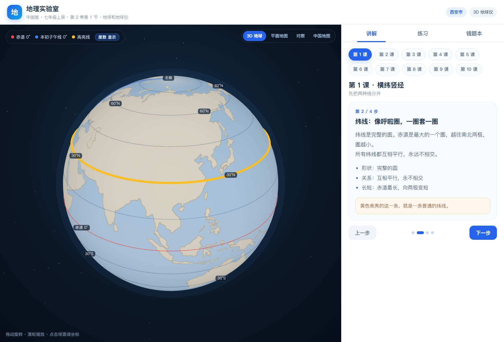
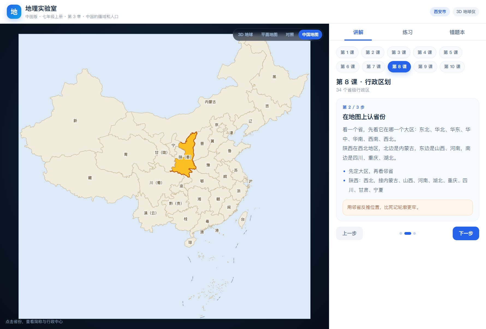

# Geography Lab

An offline-first, browser-based geography review tool for **Grade 7 (China, Zhongtu edition, 2024)**. Built with React, TypeScript and Three.js.

No backend, no account, no network required. The production build is a **single 1.4 MB HTML file** you can double-click.





## Links

- **GitHub**: https://github.com/lielie66/dxz-learning
- **Gitee mirror (China)**: https://gitee.com/acef09/dxz-learning
- **Live demo**: https://lielie66.github.io/dxz-learning/
- **Offline zip**: https://gitee.com/acef09/dxz-learning/raw/main/release/geo-lab-offline.zip

## Why

A parent built this for a 7th grader who could not understand latitude/longitude or contour maps from a flat textbook. The tool makes the abstract concrete: rotate a 3D globe, drag a water level to see how a contour line is cut, then practise with procedurally generated questions and a spaced-review wrong-answer book.

## Features

- **3D globe** with graticule, degree labels, click-to-read coordinates, and a sphere/flat/split comparison
- **China map** with provinces, rivers, terrain steps, climate charts and contour maps
- **20 lessons** following the textbook order (Earth in the universe → Earth and maps → China's territory and population → China's natural environment)
- **24 question types**, procedurally generated with anti-repetition (shuffle bags + recent-signature checks)
- **Hands-on tasks**: click a coordinate on the globe, find a province on the map
- **Wrong-answer book** with 1/3/7/15-day review scheduling and per-topic mastery
- **Single-file build**, works offline, no telemetry

## Tech

- React + TypeScript + Vite
- Three.js for the globe and the 3D terrain block
- Canvas/SVG for maps, climate charts and contour diagrams
- `vite-plugin-singlefile` for the one-file build
- localStorage for progress

## Run

```bash
npm install
npm run dev      # dev server
npm run build    # builds dist/index.html and copies it to docs/
```

Open `docs/index.html` directly, or serve `docs/` with any static server.

## Data & license

- China province boundaries: DataV GeoJSON (for personal study).
- World land outlines: Natural Earth via `world-atlas` (public domain).
- Textbook structure: Zhongtu edition (China Map Publishing House), Grade 7, 2024. Textbook content itself is not included.
- Code: MIT.

If this helps you, a ⭐ on GitHub is appreciated.
