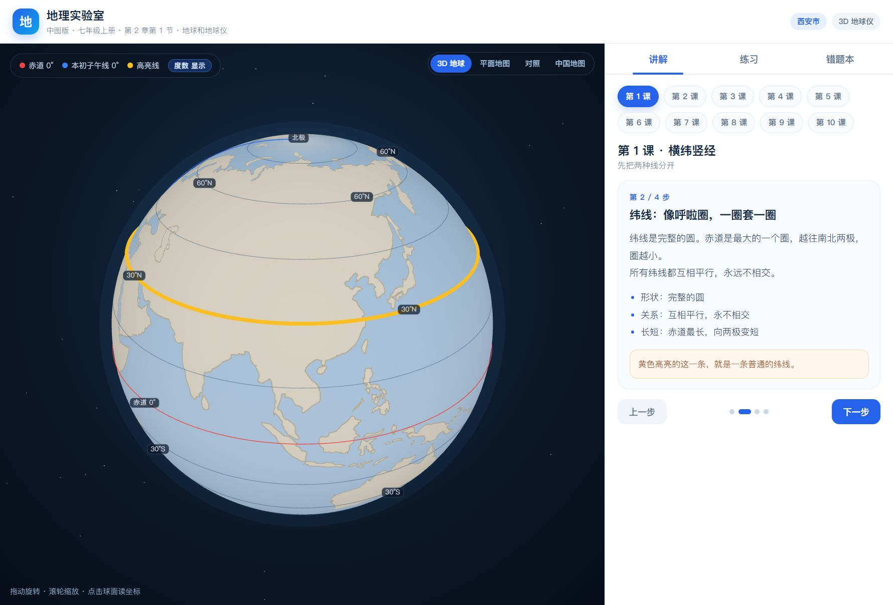
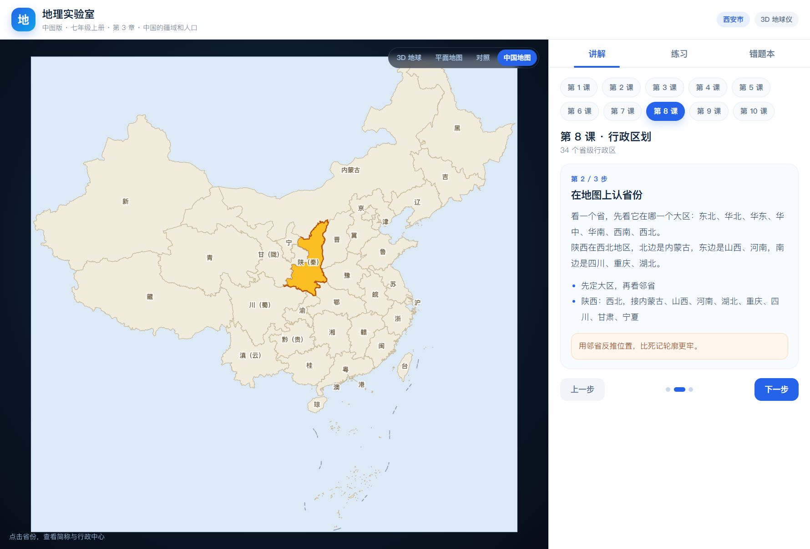

# 地理实验室

面向**七年级上学期**的纯前端地理可视化学习工具，对应**中图版（中国地图出版社）2024 年版《地理》七年级上册**，内容依据《义务教育地理课程标准（2022 年版）》编写。

不需要后端、不需要联网。构建产物是一个可以直接双击打开的 HTML 文件。

> **一键打开**：[dxz.flowzen.cn](https://dxz.flowzen.cn/)　·　**国内镜像**：[gitee.com/acef09/dxz-learning](https://gitee.com/acef09/dxz-learning)　·　**离线包**：[geo-lab-offline.zip](https://gitee.com/acef09/dxz-learning/raw/main/release/geo-lab-offline.zip)
>
> 如果这个项目对你有帮助，欢迎在 [GitHub](https://github.com/lielie66/dxz-learning) 点一个 ⭐ Star。

[English](README.en.md)

## 背景

孩子刚上初一，经纬网、等高线这些抽象概念，用课本上的平面图讲不清。于是做了这个能转、能点、能拖、能练的工具：先让她看懂，再通过随机题和错题本反复练。

现在覆盖中图版七年级上册全部四章，20 节课、24 类题，打包成一个 1.4 MB 的 HTML，双击就能用，不需要服务器。





## 适用对象与教材

| 项目 | 说明 |
|---|---|
| 年级 | 七年级上学期（初一上） |
| 教材 | 中图版（中国地图出版社）《地理》七年级上册，2024 年 6 月第 1 版 |
| 地区 | 使用中图版的地区（以学校实际教材为准） |
| 课标 | 《义务教育地理课程标准（2022 年版）》 |
| 已覆盖 | 第 1 章「地球的宇宙环境」、第 2 章「地球和地图」、第 3 章「中国的疆域和人口」、第 4 章「中国的自然环境」 |

> 如果你用的不是中图版，目录会有差异。例如人教版七上是 6 章、先世界后中国；中图版只有 4 章，且七上就进入中国地理。讲解内容可以参考，但章节对应关系需要自己调整。

## 在线使用

- **一键打开（推荐，国内可直连）**：**https://dxz.flowzen.cn/**
- **GitHub Pages**（海外 / 能访问 GitHub）：**https://lielie66.github.io/dxz-learning/**
- **Gitee 镜像仓库**（国内备用）：**https://gitee.com/acef09/dxz-learning**
- 都打不开时：下载离线包，解压后双击 `地理实验室.html`

## 离线使用

1. 下载仓库里的 `docs/index.html`，或直接下载 [geo-lab-offline.zip](https://gitee.com/acef09/dxz-learning/raw/main/release/geo-lab-offline.zip)
2. 解压后双击 `地理实验室.html`（推荐 Chrome / Edge）
3. 无需安装、无需联网

错题记录保存在浏览器 localStorage，不上传、不联网。换浏览器或清缓存会丢失。

## 功能

### 地球的宇宙环境（第 1 章）

- 地球在宇宙中：天体系统层级、太阳系八大行星、地球存在生命的条件
- 太空探索：世界航天第一、中国航天之路、探索的意义

### 地球与地图（第 2 章）

- **3D 地球仪**：拖动旋转、滚轮缩放、点击球面读出经纬度
- **经纬线度数标签**：可以随时隐藏/显示
- **球面 / 平面 / 对照**：三种视图共用同一套经纬网、标记和高亮，用来理解「球面压平后线为什么变直」
- **等高线实验室**：立体地形和俯视等高线图并排同步，拖动切面高度，看每条等高线是怎么切出来的
- **9 节讲解**：横纬竖经、北纬南纬、东经西经、读坐标、四个易错点、从球面到地图、地球形状与五带、地图三要素、等高线地形图

### 中国的疆域和人口（第 3 章）

- 中国的疆域：半球/纬度/海陆位置、领土四至、面积、邻国、四大海域
- 行政区划：省县乡三级、34 个省级行政区、简称与行政中心
- 众多的人口：14 亿、黑河—腾冲线、东多西少及原因
- 统一的多民族国家：56 个民族、分布特点、5 个自治区

### 中国的自然环境（第 4 章）

- 地势与地形：三级阶梯剖面图、分界线、主要地形区
- 气温和降水：冬夏气温特点、1 月 0℃ 等温线、800/400 毫米等降水量线
- 天气与气候：五种气候类型、气温曲线和降水柱状图判读
- 河流和湖泊：外流区与内流区、长江、黄河
- 重要分界线：秦岭—淮河、阶梯界线、400 毫米线

> 第 4 章的地图是教学示意图，等温线、河流走向、气候区边界都做了简化，用于讲清概念和读图方法，不作为精确地理数据。

### 练习与错题

- 24 类题目，程序随机生成，可持续练习
- **去重机制**：小题库用洗牌袋出题，一轮出完才重复；坐标类避开最近 30 道；随机模式不连续出同一题型
- **动手定位**：给坐标，在地球上点出来；只提示偏南/偏北、偏东/偏西，三次后公布，并用 15° 网格讲怎么数度数
- **找省份**：在中国地图上点出指定省份
- **上一题 / 下一题**：可以回看刚做过的题和解析
- **手动加入错题本**：答对但其实是蒙的，可以自己加进去
- **错题本**：按 1 / 3 / 7 / 15 天复习，按知识点统计掌握度，重练给同类型新题

## 开发

```bash
npm install
npm run dev      # 开发服务器
npm run build    # 打包成单文件，并同步到 docs/index.html
```

技术栈：Vite + React + TypeScript + Three.js。

```
src/
  App.tsx              界面、讲解/练习/错题本、视图切换
  lessons.ts           10 节课的文案与每一步的地图状态
  data/
    china.ts           34 个省级行政区的简称、行政中心
    china.json         省级行政区边界
  globe/
    Globe.tsx          Three.js 地球、经纬网、度数标签
    FlatMap.tsx        平面世界地图
    ChinaMap.tsx       中国地图
    texture.ts         用矢量陆地数据生成地球贴图
  lib/
    coords.ts          经纬度、半球、纬度带、对称点、方向、球面距离
    quiz.ts            24 类题目的生成器与去重
    wrongbook.ts       错题本存储与复习排期
```

- 改讲解文案：`src/lessons.ts`
- 加题型：`src/lib/quiz.ts` 里加 `makeXxx()`，注册到 `MAKERS` 和 `GEO_KINDS` / `CHINA_KINDS`
- 改配色字号：`src/styles.css`

## 数据与版权

- 中国省级行政区边界来自阿里云 DataV 公开 GeoJSON 接口（`100000_full`），仅用于个人学习，边界数据版权归原提供方。
- 世界陆地轮廓来自 [world-atlas](https://github.com/topojson/world-atlas)（Natural Earth 110m，公有领域）。
- 教材目录与知识点依据中图版 2024 年版七年级上册，教材内容版权归中国地图出版社所有；本项目只做知识点的可视化与练习，不包含教材原文。
- 人口数据采用 2020 年第七次全国人口普查口径（约 14.1 亿）。

## 支持这个项目

如果它帮到了你或孩子，欢迎在 [GitHub](https://github.com/lielie66/dxz-learning) 点一个 ⭐ Star，或转给需要的家长和老师。

国内访问 GitHub 不稳定时，可以用 [Gitee 镜像](https://gitee.com/acef09/dxz-learning)。

## 许可以及贡献

MIT License，见 [LICENSE](LICENSE)。

欢迎提 Issue 或 PR：教材版本差异、题目错误、新的可视化模块都可以。
